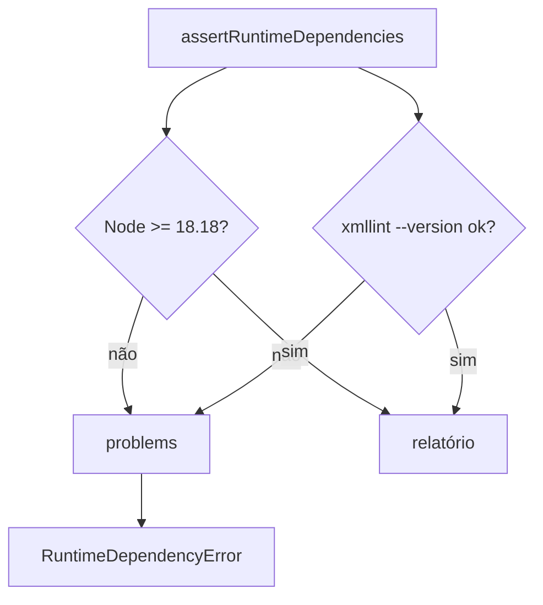

# assertRuntimeDependencies

## Visão geral

Verificação de ambiente do SDK: confirma que o host tem Node.js 18.18+ e `xmllint` (libxml2), necessário para validar o XML da NF-e contra o XSD oficial (`validateNFeXsd`).

## Responsabilidades

- `checkRuntimeDependencies(options?)`: sonda o host sem lançar e devolve `RuntimeDependenciesReport` (`nodeVersion`, `nodeSupported`, `xmllintAvailable`, `xmllintVersion?`, `problems`).
- `assertRuntimeDependencies(options?)`: lança `RuntimeDependencyError` com todas as pendências (uma frase cada) ou devolve o relatório.
- `RuntimeDependencyError`: `problems` lista o que falta; a mensagem junta as frases.

## Entradas e saídas

```ts
assertRuntimeDependencies(): RuntimeDependenciesReport;
checkRuntimeDependencies(options?: { nodeVersion?: string; probeXmllint?: () => string | undefined }): RuntimeDependenciesReport;
```

As opções existem para testes; o uso normal não passa argumentos.

## Fluxo principal



## Tratamento de erros e casos-limite

- Sem `xmllint`, `validateNFeXsd` devolve `xmllint-unavailable`; esta verificação permite falhar já na inicialização, em vez de descobrir na primeira emissão.
- Versões de Node ilegíveis são tratadas como não suportadas.
- A sondagem tem timeout de 5 s e nunca executa entrada de usuário.

## Exemplos

```ts
import { assertRuntimeDependencies } from '@linkiez/nfe-sdk';

assertRuntimeDependencies(); // lança RuntimeDependencyError se faltar xmllint
```

## Dependências e integrações

`node:child_process`; complementa [validateNFeXsd](./validate-nfe-xsd.doc.md).
