# src/index.ts

## Visao geral

Agrega a superficie publica estavel do pacote no import raiz `nfe-sdk`.

## Responsabilidades

- Reexportar o contrato publico minimo herdado da fase 003.
- Publicar a primeira facade operacional de NFC-e com `authorizeNFCe`.
- Publicar a boundary taxonomy de NFC-e com `unsupported-state` e `unsupported-scope` sem expor subpaths adicionais.
- Publicar a primeira facade operacional de NFe com `authorizeNFe`.
- Publicar os tipos de contingencia/recovery de NF-e e a facade `submitEPECEvent`.
- Publicar a reconciliacao one-shot de recibos conhecidos com metadados caller-owned de recovery.
- Publicar as primeiras consultas operacionais com `queryNFeServiceStatus` e `queryNFeDocumentSituation`.
- Publicar as manutencoes operacionais `submitNFeInutilization`, `cancelNFe` e `submitNFeCorrectionLetter`.
- Publicar o slice recipient com `distributeRecipientDFe` e `manifestRecipientOperation`.
- Publicar o helper additive `generateNFCeSPQRCode` para o recorte paulista de `QR Code`.
- Publicar `renderNFCeSPDANFE` e os tipos de entrada/resultado para DANFE NFC-e SP em HTML.
- Publicar o preparo e a reconciliacao explicita da contingencia offline SP, incluindo evidencia de calendario e classificacoes de tentativa.
- Publicar o slice generic-event com `submitGenericEvents`.
- Publicar a facade funcional inicial para criacao canonica de `NFe` e `enviNFe`.
- Publicar o slice inicial de assinatura digital com `createSigningContext` e `signNFeXml`.
- Publicar o slice inicial de transporte SOAP com resolucao de endpoint e execucao suportada.
- Evitar exposicao acidental da arvore gerada como contrato principal.

## Entradas e saidas

- Entradas: nenhuma.
- Saidas: exportacoes publicas consumidas por integradores.

## Fluxo principal

```mermaid
flowchart TD
  A[Consumer importa nfe-sdk] --> B[src/index.ts]
  B --> C[publicPackageContract]
  B --> D[authorizeNFCe]
  B --> E[authorizeNFe]
  B --> E1[submitEPECEvent]
  B --> E2[reconcileNFeReceipt]
  B --> F[cancelNFe]
  B --> G[queryNFeServiceStatus]
  B --> H[queryNFeDocumentSituation]
  B --> I[submitNFeInutilization]
  B --> J[submitNFeCorrectionLetter]
  B --> K[distributeRecipientDFe]
  B --> L[generateNFCeSPQRCode]
  B --> L1[renderNFCeSPDANFE]
  B --> M[manifestRecipientOperation]
  B --> N[submitGenericEvents]
  B --> O[createNFe]
  B --> P[createEnviNFe]
  B --> Q[createSigningContext]
  B --> R[resolveNFeServiceEndpoint]
  B --> S[executeNFeSoapService]
  B --> T[serializeNFeXml]
  B --> U[serializeEnviNFeXml]
  B --> V[signNFeXml]
```



## Tratamento de erros e casos-limite

- O arquivo apenas reexporta simbolos.
- Validacoes de entrada ficam nos modulos da facade canonica.
- O recovery usa chamadas explicitas; modo, chave, protocolo e estado nao iniciam polling nem persistencia no SDK.
- A facade NFC-e aplica bloqueios pre-transporte para UFs fora do piloto e para `requestedCapabilities` deferidas.
- O helper paulista de `QR Code` permanece restrito a `SP`, mesmo com `PR` presente no cohort de autorizacao.
- O renderer DANFE aceita evidência autorizada correlacionada ou registro offline pendente validado; nao realiza autorizacao ou consulta externa.
- O preparo offline valida a evidencia do calendario e nao transmite; a reconciliacao faz no maximo uma tentativa e nao garante replay prevention entre processos.

## Exemplos

```ts
import {
  authorizeNFCe,
  authorizeNFe,
  cancelNFe,
  createEnviNFe,
  createNFe,
  createSigningContext,
  distributeRecipientDFe,
  executeNFeSoapService,
  generateNFCeSPQRCode,
  renderNFCeSPDANFE,
  manifestRecipientOperation,
  publicPackageContract,
  queryNFeDocumentSituation,
  queryNFeServiceStatus,
  resolveNFeServiceEndpoint,
  serializeEnviNFeXml,
  serializeNFeXml,
  signNFeXml,
  submitGenericEvents,
  submitNFeCorrectionLetter,
  submitNFeInutilization,
} from 'nfe-sdk';
```

## Dependencias e integracoes

- `./public-contract.js`
- `./canonical/index.js`