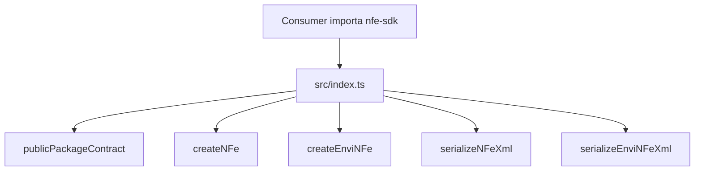

# src/index.ts

## Visao geral

Agrega a superficie publica estavel do pacote no import raiz `nfe-sdk`.

## Responsabilidades

- Reexportar o contrato publico minimo herdado da fase 003.
- Publicar a facade funcional inicial para criacao canonica de `NFe` e `enviNFe`.
- Evitar exposicao acidental da arvore gerada como contrato principal.

## Entradas e saidas

- Entradas: nenhuma.
- Saidas: exportacoes publicas consumidas por integradores.

## Fluxo principal



## Tratamento de erros e casos-limite

- O arquivo apenas reexporta simbolos.
- Validacoes de entrada ficam nos modulos da facade canonica.

## Exemplos

```ts
import {
  createEnviNFe,
  createNFe,
  publicPackageContract,
  serializeEnviNFeXml,
  serializeNFeXml,
} from 'nfe-sdk';
```

## Dependencias e integracoes

- `./public-contract.js`
- `./canonical/index.js`