# src/index.ts

## Visao geral

Agrega a superficie publica estavel do pacote no import raiz `nfe-sdk`.

## Responsabilidades

- Reexportar o contrato publico minimo herdado da fase 003.
- Publicar a primeira facade operacional de NFe com `authorizeNFe`.
- Publicar as primeiras consultas operacionais com `queryNFeServiceStatus` e `queryNFeDocumentSituation`.
- Publicar as manutencoes operacionais `submitNFeInutilization`, `cancelNFe` e `submitNFeCorrectionLetter`.
- Publicar o slice recipient com `distributeRecipientDFe` e `manifestRecipientOperation`.
- Publicar o slice generic-event com `submitGenericEvents`.
- Publicar a facade funcional inicial para criacao canonica de `NFe` e `enviNFe`.
- Publicar o slice inicial de assinatura digital com `createSigningContext` e `signNFeXml`.
- Publicar o slice inicial de transporte SOAP com resolucao de endpoint e execucao suportada.
- Evitar exposicao acidental da arvore gerada como contrato principal.

## Entradas e saidas

- Entradas: nenhuma.
- Saidas: exportacoes publicas consumidas por integradores.

## Fluxo principal

```mermaid
flowchart TD
  A[Consumer importa nfe-sdk] --> B[src/index.ts]
  B --> C[publicPackageContract]
  B --> D[authorizeNFe]
  B --> E[cancelNFe]
  B --> F[queryNFeServiceStatus]
  B --> G[queryNFeDocumentSituation]
  B --> H[submitNFeInutilization]
  B --> I[submitNFeCorrectionLetter]
  B --> J[distributeRecipientDFe]
  B --> K[manifestRecipientOperation]
  B --> L[submitGenericEvents]
  B --> M[createNFe]
  B --> N[createEnviNFe]
  B --> O[createSigningContext]
  B --> P[resolveNFeServiceEndpoint]
  B --> Q[executeNFeSoapService]
  B --> R[serializeNFeXml]
  B --> S[serializeEnviNFeXml]
  B --> T[signNFeXml]
```



## Tratamento de erros e casos-limite

- O arquivo apenas reexporta simbolos.
- Validacoes de entrada ficam nos modulos da facade canonica.

## Exemplos

```ts
import {
  authorizeNFe,
  cancelNFe,
  createEnviNFe,
  createNFe,
  createSigningContext,
  distributeRecipientDFe,
  executeNFeSoapService,
  manifestRecipientOperation,
  publicPackageContract,
  queryNFeDocumentSituation,
  queryNFeServiceStatus,
  resolveNFeServiceEndpoint,
  serializeEnviNFeXml,
  serializeNFeXml,
  signNFeXml,
  submitGenericEvents,
  submitNFeCorrectionLetter,
  submitNFeInutilization,
} from 'nfe-sdk';
```

## Dependencias e integracoes

- `./public-contract.js`
- `./canonical/index.js`