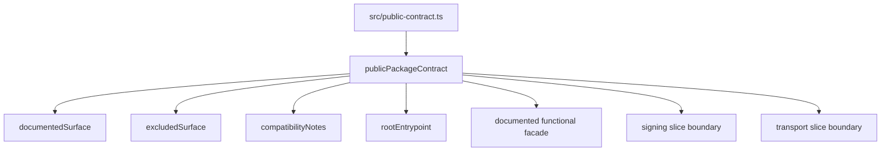

# src/public-contract.ts

## Visao geral

Descreve o contrato publico estabilizado no import raiz do pacote.

## Responsabilidades

- Registrar a superficie documentada do root import.
- Explicitar exclusoes e notas de compatibilidade.
- Descrever a ampliacao additive do slice inicial de assinatura digital.
- Descrever a ampliacao additive do slice inicial de transporte SOAP.
- Servir como evidencia programatica do contrato publico.

## Entradas e saidas

- Entradas: nenhuma.
- Saidas: objeto `publicPackageContract` exportado no root import.

## Fluxo principal



## Tratamento de erros e casos-limite

- O arquivo apenas materializa metadados do contrato.
- Nao realiza validacoes de entrada em runtime.

## Exemplos

```ts
import { publicPackageContract } from 'nfe-sdk';
```

## Dependencias e integracoes

- `src/index.ts`
- `README.md`
- `specs/003-public-package-contract/contracts/public-package-contract.md`
- `specs/004-iniciar-sdk/contracts/public-functional-facade.md`
- `specs/005-add-digital-signing/contracts/public-signing-facade.md`
- `specs/006-add-soap-transport/contracts/public-soap-transport-facade.md`