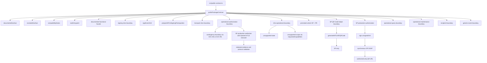

# src/public-contract.ts

## Visao geral

Descreve o contrato publico estabilizado no import raiz do pacote.

## Responsabilidades

- Registrar a superficie documentada do root import.
- Explicitar exclusoes e notas de compatibilidade.
- Descrever a ampliacao additive do slice inicial de assinatura digital.
- Descrever a ampliacao additive do slice de expansao de assinatura para `evento` XML e precondicoes de `NFC-e`.
- Descrever a ampliacao additive do slice inicial de transporte SOAP.
- Descrever a ampliacao additive da facade operacional de autorizacao, consultas e manutencoes homologadas.
- Registrar que `authorizeNFe` agora devolve `contingency-boundary` explicita para `SVC-AN` e `SVC-RS` quando o pedido de producao cai na trilha observavel promovida.
- Registrar a autorizacao de producao limitada a identidade SP, com executor mTLS injetado e sem fallback automatico para contingencia.
- Descrever a preservacao de metadados diagnosticos sem expor valores sensiveis e os erros de protocolo por `tpAmb`, `nProt` ou `nRec` inconsistentes.
- Descrever a ampliacao additive da facade operacional inicial de NFC-e homologada para o cohort promovido `SP + PR`.
- Descrever a ampliacao additive do helper paulista `generateNFCeSPQRCode` como recorte menor que o cohort `SP + PR`.
- Registrar a autorizacao NFC-e homologada `SP + PR` e a autorizacao sincrona de producao SP modelo 65 com XML fiscal assinado.
- Registrar os prerequisitos de producao `unsignedXml`, `SigningContext`, executor mTLS injetado e CSC, alem da associacao opcional do QR Code a autorizacao confirmada.
- Registrar que a facade NFC-e distingue `unsupported-state` e `unsupported-scope` antes do transporte e preserva DANFE, credenciamento e contingencia fora do runtime.
- Descrever a ampliacao additive do slice recipient homologado para distribuicao DFe e manifestacao.
- Descrever a ampliacao additive do slice generic-event homologado para submissao de eventos suportados por uma facade unica.
- Registrar que o slice generic-event mantem limites e exclusoes de escopo como boundary pre-transport explicita.
- Servir como evidencia programatica do contrato publico.

## Entradas e saidas

- Entradas: nenhuma.
- Saidas: objeto `publicPackageContract` exportado no root import.

## Fluxo principal



## Tratamento de erros e casos-limite

- O arquivo apenas materializa metadados do contrato.
- Nao realiza validacoes de entrada em runtime.
- O helper paulista de `QR Code` precisa aparecer como additive e explicitamente menor que o recorte `SP + PR`.
- A autorizacao NF-e em producao permanece limitada a SP e exige executor configurado pelo integrador para mTLS.
- A autorizacao NFC-e em producao permanece limitada a um unico documento SP modelo 65, com XML/ambiente coerentes, sem retry, polling ou fallback.

## Exemplos

```ts
import { publicPackageContract } from 'nfe-sdk';
```

## Dependencias e integracoes

- `src/index.ts`
- `README.md`
- `specs/003-public-package-contract/contracts/public-package-contract.md`
- `specs/004-iniciar-sdk/contracts/public-functional-facade.md`
- `specs/005-add-digital-signing/contracts/public-signing-facade.md`
- `specs/014-expand-signing-coverage/contracts/public-signing-expansion-facade.md`
- `specs/006-add-soap-transport/contracts/public-soap-transport-facade.md`
- `specs/007-nfe-operational-mvp/contracts/public-nfe-operational-facade.md`
- `specs/010-nfce-national-core/contracts/public-nfce-operational-facade.md`
- `specs/024-nfce-sp-qrcode/contracts/public-nfce-sp-qrcode-facade.md`
- `specs/008-recipient-dfe-mvp/contracts/public-recipient-dfe-facade.md`
- `specs/009-generic-event-mvp/contracts/public-generic-event-facade.md`
- `specs/025-nfe-sp-producao/contracts/public-nfe-sp-production-authorization.md`