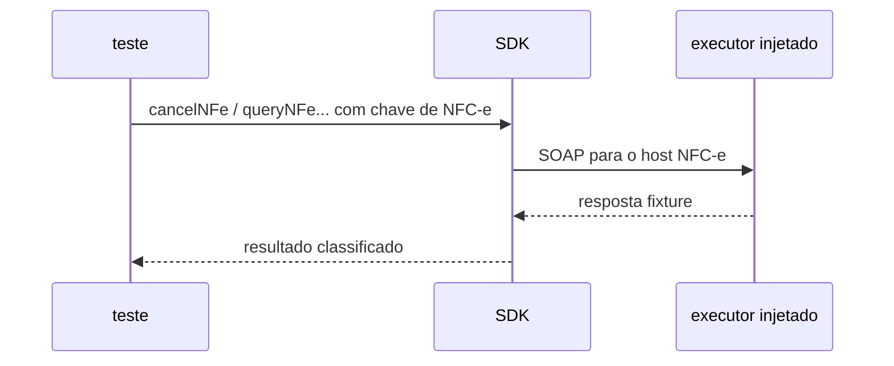

# nfce-lifecycle-sp.test

## Visão geral

Testes de integração do ciclo de vida da NFC-e (modelo 65) em SP: consulta de status e de situação, cancelamento, cancelamento por substituição e inutilização.

## Responsabilidades

Provar os endereços oficiais (produção e homologação), a escolha do serviço pelo modelo da chave, o evento 110112 válido contra o XSD oficial, as recusas antes de assinar e a dispensa da inutilização em SP, AC e BA.

## Entradas e saídas

Executor de requisição injetado captura endereço, envelope e cabeçalhos; certificado A1 de teste assina os eventos.

## Fluxo principal

## Tratamento de erros e casos-limite

Substituição sem versão da aplicação, com chave que não é de NFC-e ou igual à da nota é `usage-error` sem requisição; inutilização de SP, AC e BA é `unsupported-scope`.

## Exemplos

`resolveNFeServiceEndpoint({ authorizer: 'SP', environment: 'production', service: 'nfce-event' })` aponta para `nfce.fazenda.sp.gov.br`.

## Dependências e integrações

Jest, certificado de teste e XSD de `xsd/Evento_CancSubst_v1.01_NT_2018_004`.
