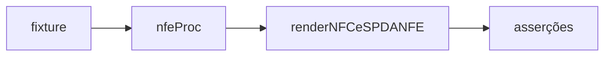

# render-nfce-sp-danfe-authorized-xml.test

## Visão geral

Testes do DANFE NFC-e desenhado a partir do `nfeProc` autorizado.

## Responsabilidades

Cobrir producao e homologacao, largura de papel, `cStat` 150 e as recusas: protocolo que nao autoriza, chave ou ambiente divergentes, UF e modelo errados, QR Code divergente, protocolo ausente, XML malformado, copia do estabelecimento e largura invalida.

## Entradas e saídas

O `nfeProc` e montado a partir da fixture sanitizada `sp-danfe-authorization-outcomes`.

## Fluxo principal

## Tratamento de erros e casos-limite

Cada recusa verifica a mensagem de `NFCeOperationalUsageError`.

## Exemplos

`buildAuthorizedXml('homologation')` gera o documento de homologacao.

## Dependências e integrações

Jest.
